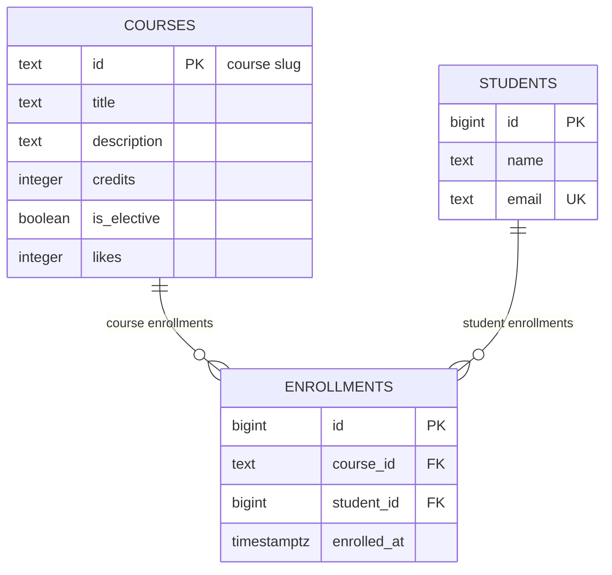

# course-catalog-db

PostgreSQL schema for the course catalog (Lab 6, "Advanced Web Technologies").

## How to run

PostgreSQL 16 or newer is required. Once, as the `postgres` superuser:

```sql
CREATE ROLE catalog_app LOGIN PASSWORD 'change-me';
CREATE DATABASE course_catalog OWNER catalog_app;
```

Then, from the project folder (it stops at the first error):

```bash
psql -h localhost -U catalog_app -d course_catalog -v ON_ERROR_STOP=1 -f schema.sql
psql -h localhost -U catalog_app -d course_catalog -v ON_ERROR_STOP=1 -f seed.sql
psql -h localhost -U catalog_app -d course_catalog -v ON_ERROR_STOP=1 -f queries.sql
```

The password `change-me` is for teaching; real projects keep passwords out of git.

---

## Schema



The schema has three tables. `courses` and `students` are independent entities; `enrollments` links them in a many-to-many relationship — one student can enroll in many courses, one course can have many students. The `enrollments` table is the junction table that resolves the many-to-many relationship into two one-to-many relationships.

---

## Design decisions

- **`courses.id` is text (a slug) while `students.id` is an automatic number.** A course slug like `modern-frontend` is a stable, human-readable identifier chosen by administrators — it appears in URLs and doesn't change. An automatic `bigint` is better for students because there is no natural unique text identifier: a name or email can change, while a system-generated number never conflicts and requires no manual assignment.

- **`RESTRICT` on `enrollments.course_id` but `CASCADE` on `enrollments.student_id`.** Deleting a course that still has enrolled students should be blocked (RESTRICT) — it is a business error that requires manual cleanup first. Deleting a student, on the other hand, should clean up all their enrollments automatically (CASCADE), because enrollments without a student are meaningless orphan rows.

- **`timestamptz` instead of `timestamp`, and `text` instead of `varchar(n)`.** `timestamptz` stores the UTC offset alongside the moment, so the value is unambiguous regardless of the server's timezone — important for distributed or cloud deployments. `text` in PostgreSQL has no performance or storage disadvantage over `varchar(n)`; a length limit adds no value unless the domain genuinely requires one, and an arbitrary cap like `varchar(255)` just causes migration pain later.

---

## Constraint violation log

Commands were run with `\set VERBOSITY verbose`.

| # | What we violate | SQLSTATE | Constraint | API response |
|---|-----------------|----------|------------|--------------|
| 1 | NULL in courses.title | 23502 | NOT NULL — column `title` (no constraint name) | 422 |
| 2 | courses.credits = 0 | 23514 | courses_credits_check | 422 |
| 3 | courses.likes = -1 | 23514 | courses_likes_check | 500 (bug in code) |
| 4 | a one-letter student name | 23514 | students_name_check | 422 |
| 5 | a duplicate student email | 23505 | students_email_key | 409 Conflict |
| 6 | a duplicate course id | 23505 | courses_pkey | 409 Conflict |
| 7 | a repeated enrollment in a course | 23505 | enrollments_course_id_student_id_key | 409 Conflict |
| 8 | enrolling in a nonexistent course | 23503 | enrollments_course_id_fkey | 404 Not Found |
| 9 | enrolling a nonexistent student | 23503 | enrollments_student_id_fkey | 404 Not Found |
| 10 | deleting a course that has enrollments | 23503 | enrollments_course_id_fkey | 409 Conflict |
| 11 | CASCADE delete of a student | no error | ON DELETE CASCADE | — enrollments deleted automatically, 6 → 3, 6 after ROLLBACK |

**Why check in the database if Pydantic already checks the same rule?**
Pydantic validates data that arrives through the API, but it is not the only writer. Direct SQL scripts, migrations, admin tools, background jobs, or a second microservice may all write to the same database, bypassing the API entirely. The database constraint is the last line of defence: it enforces the rule unconditionally, regardless of who or what sends the data.

---

## Index: EXPLAIN before and after

Query: `SELECT * FROM enrollments WHERE student_id = 777;`  
Database `idx_demo`: 500 courses, 20,000 students, 50,000 enrollments.

| | Before the index | After the index |
|---|------------------|-----------------|
| Access method | Seq Scan | Bitmap Heap Scan → Bitmap Index Scan |
| cost | 0.00..1042.00 | 4.31..15.59 |
| Rows Removed by Filter | 49,997 | 0 (index used) |
| Execution Time | ~3–5 ms | ~0.1–0.3 ms |

**Before the index:**
```
Seq Scan on enrollments  (cost=0.00..1042.00 rows=3 width=34)
  Filter: (student_id = 777)
  Rows Removed by Filter: 49997
```

**After the index:**
```
Bitmap Heap Scan on enrollments  (cost=4.31..15.59 rows=3 width=34)
  Recheck Cond: (student_id = 777)
  ->  Bitmap Index Scan on enrollments_student_id_idx  (cost=0.00..4.31 rows=3 width=0)
        Index Cond: (student_id = 777)
```

**Answers:**

1. **Why didn't PostgreSQL create an index on `enrollments.student_id` automatically?** PostgreSQL automatically creates indexes for `PRIMARY KEY` and `UNIQUE` constraints only. A `FOREIGN KEY` constraint does not get an automatic index — the designer must create it manually if queries on that column are expected.

2. **Why does a primary-key lookup on `courses` (6 rows) use `Seq Scan`, while on `enrollments` (50k rows) it uses an index?** The query planner compares costs. For a 6-row table that fits on a single data page, reading the whole page (cost ~1) is cheaper than following index pointers. With 50,000 rows spread across many pages, the index narrows the search to a few rows and avoids reading the entire table.

3. **Two operations that the index on `student_id` will speed up:**
   - `SELECT * FROM enrollments WHERE student_id = ?` — looking up a student's enrollments (used by the GET /enrollments route).
   - `DELETE FROM students WHERE id = ?` — when a student is deleted with CASCADE, PostgreSQL must find and delete all their enrollments; without the index it scans the full table.

---

## Transaction

Scenario: enroll a new student in a course — two inserts in one transaction.

- **The second insert failed:** psql printed `ERROR: insert or update on table "enrollments" violates foreign key constraint "enrollments_course_id_fkey"`. The prompt changed to `=!>` (transaction aborted). Every subsequent command, even a plain `SELECT`, was rejected with "current transaction is aborted, commands ignored until end of transaction block". After `ROLLBACK`, the first insert (the new student) was also rolled back — `SELECT count(*) FROM students WHERE email = 'madina@example.com'` returned 0. No student without an enrollment was left in the database.

- **Window B saw `count = 0`** before `COMMIT` in window A, and **`count = 1`** after `COMMIT`. Changes are invisible to other connections until the transaction commits — this is the **read committed** isolation level (the PostgreSQL default).

- **Without a transaction**, if the second insert had failed, the first insert (the student row) would have been permanently saved. The database would contain a student with no enrollment — an inconsistent state that would require manual cleanup.

---

## Self-review against the checklist

| What to check | Result |
|---------------|--------|
| Keys | ✅ Every table has a primary key. Foreign keys on `enrollments.course_id` → `courses` and `enrollments.student_id` → `students`. |
| Types | ✅ `bigint` for auto-generated IDs, `text` for strings, `boolean` for yes/no, `integer` for counts, `timestamptz` for moments in time. |
| Required values | ✅ All columns that must have a value are `NOT NULL`. `is_elective`, `likes`, and `enrolled_at` have sensible defaults. |
| Constraints | ✅ `CHECK (credits > 0)`, `CHECK (likes >= 0)`, `CHECK (length(name) >= 2)`, `UNIQUE (email)`, `UNIQUE (course_id, student_id)` — consistent with Pydantic validators in the API. |
| Deletion | ✅ `RESTRICT` on `course_id` (block deleting a course that has enrollments), `CASCADE` on `student_id` (auto-delete enrollments when a student is removed). Both chosen deliberately. |
| Normalization | ✅ Each fact is stored in one place: course data in `courses`, student data in `students`, the enrollment relationship in `enrollments`. No repeated groups or lists in a single cell. |
| Indexes and names | ✅ Indexes on `PRIMARY KEY` and `UNIQUE` are automatic; `enrollments_student_id_idx` added manually for the foreign key. No unnecessary indexes. Names follow `snake_case`, tables are plural nouns, foreign keys follow the `table_column` convention. |

---

## Bonus experiments

The `experiments/` folder contains two additional SQL files:

- `idx_data.sql` — loads 500 courses, 20,000 students, and 50,000 enrollments into the `idx_demo` database for the index experiment (Step 6).
- `norm_demo.sql` — creates a flat `registrations` table in `norm_demo` to demonstrate the three normalization anomalies (update, delete, insert) described in Bonus Task 1.
